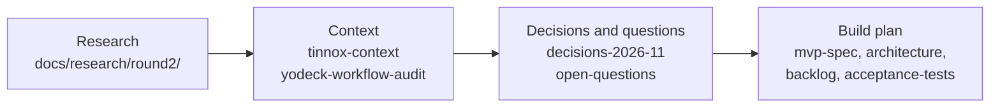

# TINNOX CMS (CMS-RE-Cloud)

TINNOX sells and installs LED walls, outdoor LED signs, pylons, billboards and kiosks across Australia. **TINNOX CMS** is the content management software TINNOX will sell with that hardware: customers upload images, video and PDFs, schedule them, publish them to their screens, and see proof that they are playing. TINNOX staff use the same platform to provision devices, watch the fleet and support customers.

**Where the project is today:** discovery is finished, and the first internal prototype (milestone M0) runs locally. M0 is a **browser prototype**: an operator portal, an API, an isolated media-validation worker and a browser player, with synthetic data only. It is not a production system, it is not certified or assessed against any standard, and it says nothing yet about NovaStar or Huidu compatibility; that needs the model-specific hardware test in [`docs/hardware-next-step.md`](docs/hardware-next-step.md). What was run and what passed is recorded in [`docs/prototype-validation.md`](docs/prototype-validation.md). The discovery documents in [`docs/`](docs/) are dated 3 November 2026 and most of them are **PROPOSED**, meaning they wait for TINNOX to approve or amend them.

---

## Run the prototype

Everything runs on your own machine. Nothing is deployed and nothing contacts a cloud service at run time.

### Prerequisites

- macOS or Linux, with Docker Desktop (or Docker Engine with Compose v2) running.
- Node.js 22.13 or newer (22.13 is the lowest Node 22 release that ESLint 10 supports) and npm 10 or newer. `.nvmrc` says 22. Every recorded test run so far used Node 23.10, which is outside the supported range of ESLint 10 and vitest 5 (they warn at install); no run on Node 22 has been recorded yet.
- Free local ports: 4000 (API), 5173 (portal), 5174 (player), 8080 (Keycloak) and 54329 for PostgreSQL. If 54329 is taken, setup picks the next free port and writes it to `.env` (on the first development machine it is 54330).
- Google Chrome or Chromium for the player. The end-to-end tests use Playwright's own Chromium (`npx playwright install chromium` once).

### First-time setup

From the repository root:

```sh
npm ci                              # exact dependency versions from package-lock.json
npm run setup                       # generates .env and the development identities (gitignored)
npm run infra:up                    # PostgreSQL, Keycloak and the media worker container; waits until healthy
npm run db:migrate                  # applies db/migrations as the migration role
npm run db:seed -- --second-org     # "TINNOX Internal" + site "Melbourne Workshop", and a second test organisation
npm run verify:oidc                 # optional: proves the Keycloak sign-in (PKCE, password, one-time code)
```

`npm run setup` creates random development secrets (all start with `dev-`) in `.env` and `infra/.generated/`. Both are gitignored; never commit them. The API refuses to start with them when `NODE_ENV=production`.

### Start

```sh
npm run dev        # starts infra (if needed), then the API, the portal and the player together; Ctrl+C stops them
```

| What | URL |
|---|---|
| Operator portal | http://localhost:5173 |
| Browser player | http://localhost:5174 (open it in a separate window, ideally another browser profile) |
| API health | http://localhost:4000/readyz |
| Keycloak administration (optional) | http://localhost:8080/admin (user `KC_BOOTSTRAP_ADMIN_USERNAME`, password `KC_BOOTSTRAP_ADMIN_PASSWORD`, both in `.env`) |

Use `localhost`, not `127.0.0.1`, in the browser: the sign-in redirect, the session cookie and the signed media URLs are registered for `localhost`. For a database client the opposite holds: connect to `127.0.0.1:<POSTGRES_HOST_PORT>`, because PostgreSQL listens on IPv4 only and `localhost` may resolve to `::1`, where another program can hold the same port (setup now checks both addresses when it chooses a port).

`npm run start:built` runs the production builds of the portal and player instead (the player's service worker, and therefore offline reload, exists only in a build).

### Sign-in details

```sh
npm run otp -- --show-password      # username, password and the current one-time code of the operator
npm run otp -- --second             # the operator of the second test organisation
```

The one-time code changes every 30 seconds, and Keycloak accepts each code once. If a code is refused, wait for the next one. The values come from `infra/.generated/dev-credentials.json`; they exist only in your local Keycloak.

### Walkthrough

1. Open http://localhost:5173 and choose **Sign in**. Enter the username and password from `npm run otp -- --show-password`, then the one-time code.
2. **Displays → New display.** Give it a name and a canvas (for example 1920 × 1080, or 1080 × 1920 for portrait). Optionally set a content rectangle and the default fit (contain or cover).
3. Open http://localhost:5174 in another window. The player shows an 8-character pairing code for 10 minutes.
4. In the portal, open the display, enter the code under **Player pairing** and choose **Pair player**. The player changes to "registered" within a few seconds.
5. **Media**: upload a JPEG, a PNG and an H.264 MP4. Each goes through *processing* to *ready*, or to *failed* with a reason (an HEVC video, for example, is refused with an explanation). `npm run fixtures` writes small synthetic samples to `apps/api/test-fixtures/out/`.
6. **Playlists → New playlist.** Add the files, reorder them, set image durations (videos use their own length; playback is muted), and **Save draft**.
7. **Publish to display**. The player downloads every file, checks its size and SHA-256, and switches over at an item boundary.
8. Back on the display page, the status panel shows the desired, downloaded and player-reported active publication, the current item, the last report time, and any delivery errors. A report older than the stale limit is marked stale.
9. Edit and save the playlist again: the player keeps showing the published version until you publish again.
10. Stop the network (or the API) and the player keeps playing from its cache; it reports again when the network returns.
11. **Revoke player** on the display page: the player loses access at its next contact, removes its cached content and shows the unregistered screen, with **Reset this player** to pair again. On a registered player, press `d` for diagnostics and the two-step local reset.

### Tests

| Suite | Command | Needs |
|---|---|---|
| Type check, lint, format | `npm run typecheck && npm run lint && npm run format:check` | nothing running |
| Unit tests | `npm test` | nothing running |
| Builds | `npm run build` | nothing running |
| Integration and security-boundary tests | `npm run fixtures && npm run test:integration` | `npm run infra:up`; rebuilds the database `tinnox_test` itself |
| Browser end-to-end tests (Playwright, Chromium) | `npm run test:e2e` | infra up; the API, portal and player must **not** be running (Playwright starts them); about 6.5 minutes. It rebuilds its own database `tinnox_e2e_test` and uses `tests/.run/media`, so the development data is not touched, but it **restarts the shared PostgreSQL container** once (restart test) and shares `data/jobs` with the development worker |
| Dependency audit | `npm run audit` | network access to the npm registry |
| Secret scan | `npm run scan:secrets` | Docker (gitleaks container, no network) |
| Backup and restore exercise | `npm run backup:verify` | infra up, API stopped |

The end-to-end suite writes screenshots of key states and its measurements to `tests/.run/evidence/` (gitignored). The evidence cited in the validation record lives in `docs/evidence/`; refresh it deliberately with `E2E_EVIDENCE_DIR=docs/evidence npm run test:e2e`. At the end of a run the saved operator sessions are signed out and their browser states deleted. Results of the last full run are in [`docs/prototype-validation.md`](docs/prototype-validation.md).

### Reset everything

```sh
npm run infra:down                  # stop the containers, keep the data
npm run reset -- --yes              # delete the database volume, Keycloak state and ./data (uploaded media)
npm run infra:up && npm run db:migrate && npm run db:seed -- --second-org
```

`npm run reset` keeps `.env` and the generated identities. For brand-new secrets as well, delete `.env` and `infra/.generated/` after the reset and run `npm run setup` again. The player keeps its own browser storage; use its local reset (`d`, then **Reset this player…** twice) or clear the site data of http://localhost:5174.

### Where things are

| Path | What |
|---|---|
| `apps/api` | Fastify API: sign-in (OIDC backend-for-frontend), displays, pairing, media, playlists, publishing, player protocol, status, audit |
| `apps/media-worker` | Upload inspection in a container with no network, read-only root, non-root user, CPU/memory/PID limits |
| `apps/portal` | Operator portal (React, Vite) |
| `apps/player-web` | Browser player (TypeScript, service worker, IndexedDB and Cache Storage) |
| `packages/*` | Shared contracts (zod schemas), domain rules, delivery port, storage, database helpers |
| `db/migrations` | PostgreSQL schema with forced row-level security |
| `tests/` | Integration, security-boundary and end-to-end tests |
| `docs/prototype-m0.md` | M0 scope, architecture decisions D1 to D19, deviations |
| `docs/player-protocol-v1.md` | Player protocol |
| `docs/security/` | Threat model, control matrix, operations and release checklist |
| `docs/prototype-validation.md` | What was run, real results, limitations |

---

## Start here: a reading guide

You don't need to read all ~5,800 lines. Read the five documents below in order (about 2 to 3 hours in all). Treat the rest as reference you open only when a question comes up.

| Step | Read | Why | Time |
|---|---|---|---|
| 1 | [`docs/decisions-2026-11.md`](docs/decisions-2026-11.md), all of it | **The one-page summary of the whole project.** It has 29 numbered decisions (DEC-01 to DEC-29), each marked *DECIDED by client* or *PROPOSED for TINNOX approval*, plus recommended answers on support access, hosting cost and player hardware. If you read only one document, read this one. | 30 min |
| 2 | [`docs/open-questions.md`](docs/open-questions.md), sections 2.1 and 6 | **What TINNOX still has to answer (Q13 to Q26), and what happens next.** Q13 (which vendor gave API access) and Q14 (which controller each product package uses) block the controller adapter work and the Huidu hardware order. Platform work can start without them. | 15 min |
| 3 | [`docs/tinnox-mvp-spec.md`](docs/tinnox-mvp-spec.md), sections 1 to 4 | **What release 1 does and does not include**: purpose, the eight product principles, personas and scenarios, and the in-scope and out-of-scope tables. Sections 5 to 20 are detail you can skim. | 30 min |
| 4 | [`docs/implementation-backlog.md`](docs/implementation-backlog.md), sections 0, 2 and 3 | **How it gets built, and in what order.** It covers the first milestone ("one display, one site, honest states"), a 5-phase plan of about 22 weeks for two to three engineers, and the main risks. Section 1 lists the epics (A to N) in detail. | 20 min |
| 5 | [`docs/architecture-and-hardware.md`](docs/architecture-and-hardware.md), sections 1, 2, 5, 6, 7 and 8 | **How it is built and what it runs on**: system topology, how content reaches Huidu and NovaStar LED controllers, the pilot hardware, why we build rather than adapt Xibo, the tech stack, and monthly running costs. | 40 min |

**Then act on it:** [`docs/gaps-and-first-steps.md`](docs/gaps-and-first-steps.md) is a later review (9 November 2026) of the whole pack. It has a checklist for the first two weeks, the security and compliance baseline for a first release, the hardware to prepare, and the inconsistencies found between the documents.

**A quick check worth doing early:** [`docs/tinnox-context.md`](docs/tinnox-context.md) describes TINNOX itself (products, warranty, services, branding) as it was pieced together from tinnox.com.au. You know the business, so you can spot anything wrong here in minutes, and some decisions rest on it. For example, NovaStar became the second controller vendor because the website names it.

### While you review: what to look for

- **DECIDED versus PROPOSED.** Rows marked DECIDED came from TINNOX's answers to Q1 to Q12. Rows marked PROPOSED are recommendations. These are where your judgement matters most.
- **Commercial assumptions:** pricing tiers (DEC-25), plan retention (DEC-19), and "a lapse locks publishing, never playback" (DEC-26).
- **Support access (DEC-17, "B+").** Should TINNOX staff see customer content only when the customer grants access?
- **Hosting (DEC-13).** All customer data stays in Australia, on AWS Sydney with disaster recovery in Melbourne.
- **Hardware (DEC-20, DEC-21)**: Raspberry Pi CM5 boxes for LED walls, RK3588 Android boxes for kiosks, and Huidu cards driven directly for simple signs.
- Anything in the docs that contradicts what you know about TINNOX's products, customers or installed base.

---

## How the documents are organised

The documents fall into four groups. Each group feeds the next.



### 1. Decisions and questions: read first

| Document | What it is | Size |
|---|---|---|
| [`decisions-2026-11.md`](docs/decisions-2026-11.md) | The decision register (DEC-01 to DEC-29), the page TINNOX approves | 94 lines |
| [`open-questions.md`](docs/open-questions.md) | Blockers, questions for TINNOX (Q1 to Q26 with answers so far), assumptions (A-numbers), things that need real hardware, and next actions | 142 lines |
| [`gaps-and-first-steps.md`](docs/gaps-and-first-steps.md) | Review of 9 November 2026: first-two-weeks checklist, launch baseline for security and Australian compliance, what is deferred until a large buyer appears, hardware list, and inconsistencies in the pack | 184 lines |

### 2. Build plan: what we will build

| Document | What it is | Size |
|---|---|---|
| [`tinnox-mvp-spec.md`](docs/tinnox-mvp-spec.md) | The release-1 product specification: scope, workflows for the customer portal and TINNOX operations console, roles, scheduling and time zones, publishing states, player behaviour, media rules, API, commercial hooks | 500 lines |
| [`architecture-and-hardware.md`](docs/architecture-and-hardware.md) | System design, the hardware questionnaire and compatibility matrix, LED integration routes, the pilot hardware, build versus Xibo versus white label, tech stack and running costs | 349 lines |
| [`implementation-backlog.md`](docs/implementation-backlog.md) | Epics A to N with stories, priorities (P0, P1, P2) and sizes, the phase plan, and risks | 206 lines |
| [`acceptance-tests.md`](docs/acceptance-tests.md) | The tests that define "done" for release 1, grouped by area (isolation, provisioning, media, scheduling, publishing, offline, updates, monitoring, Huidu, licensing) | 214 lines |

### 3. Context: background you can consult as needed

| Document | What it is | Size |
|---|---|---|
| [`tinnox-context.md`](docs/tinnox-context.md) | TINNOX's business as read from its website: products, services, branding, what owning software means | 248 lines |
| [`yodeck-workflow-audit.md`](docs/yodeck-workflow-audit.md) | How Yodeck (an existing signage CMS) handles each workflow, from its public help centre and API. **Reference only.** Nothing is copied, and the signed-in Yodeck app was never inspected. It is the longest document; open only the area you care about (section 3.x). | 720 lines |
| [`rea-evaluation.md`](docs/rea-evaluation.md) | Evaluation of REA, a browser-evidence tool. The verdict: not needed, plain Playwright does the job. **Low priority**; you can skip it. | 120 lines |

### 4. Research: the evidence behind the decisions

[`docs/research/round2/`](docs/research/round2/) holds the second round of research. Every claim in the main documents points back to one of these files. You only need them to check where a fact came from.

| File | Topic |
|---|---|
| [R99-critic.md](docs/research/round2/R99-critic.md) | **The summary of round 2**: contradictions found (C1 to C15) and how each was resolved, the edits made to each doc, and what only TINNOX or real hardware can answer. Read this one first among the research files. |
| [R1-huidu-integration.md](docs/research/round2/R1-huidu-integration.md) | Huidu controllers and their HTTP API: how the CMS should talk to them |
| [R2-support-access-models.md](docs/research/round2/R2-support-access-models.md) | How other vendors give support staff access to customer accounts; source of the B+ policy |
| [R3-au-hosting-compliance.md](docs/research/round2/R3-au-hosting-compliance.md) | Australian hosting options, compliance, and the cost model at 10 to 2,000 screens |
| [R4-player-hardware-recommendation.md](docs/research/round2/R4-player-hardware-recommendation.md) | Player hardware choices, including heat in Australian outdoor cabinets |
| [R5-tinnox-site.md](docs/research/round2/R5-tinnox-site.md) | tinnox.com.au read page by page |
| [R6-commercial-model.md](docs/research/round2/R6-commercial-model.md) | CMS pricing in the market, bundling models, and the proposed TINNOX tiers |
| [R7-yodeck-api-spec.md](docs/research/round2/R7-yodeck-api-spec.md) | Yodeck's public API read in full |
| [R8-xibo-verify.md](docs/research/round2/R8-xibo-verify.md) | Fact-check of Xibo (open-source CMS) licensing, pricing and terms |
| [AV1](docs/research/round2/AV1-accounts-admin.md) to [AV5](docs/research/round2/AV5-publish-monitor-offline.md) | Claim-by-claim checks of the Yodeck audit (accounts, registration and API, media and playlists, layouts and scheduling, publishing, monitoring and offline) |

Some files mention a `scratchpad/` folder (for example the round-1 notes `A01` and `T01`). That folder was the research session's temporary workspace and is **not in this repository**.

---

## Decoding the documents

The docs use a few conventions throughout. Once you know them, the documents read much faster.

**Evidence labels.** Each fact says how sure we are of it:

| Label | Means |
|---|---|
| VERIFIED_FULL_PAGE | An official page or spec was read in full |
| OFFICIALLY DOCUMENTED | Official source, but seen only in part or through a search summary |
| THIRD PARTY | Resellers, forums, blogs: lower confidence |
| INFERRED | Our deduction; treat it as a hypothesis |
| UNKNOWN | Searched for and not found |
| HARDWARE-DEPENDENT/UNVERIFIED | Needs testing on the real device |
| PROPOSED | Our recommendation, not a fact |

**IDs you will see:**

| ID | Meaning | Defined in |
|---|---|---|
| DEC-01 to DEC-29 | Decisions | `decisions-2026-11.md` |
| Q1 to Q12 | Questions TINNOX has already answered | `open-questions.md` section 2 |
| Q13 to Q26 | Open questions for TINNOX. **The same questions are also called Q-T1 to Q-T14** (Q-T1 = Q13, Q-T2 = Q14, and so on). | `open-questions.md` section 2.1 |
| A1, A2, … | Assumptions | `open-questions.md` section 4 |
| B1 to B6 | Blockers from the research session | `open-questions.md` section 1 |
| C1 to C15 | Contradictions found and resolved in round 2 | `research/round2/R99-critic.md` |
| Epic A to N, A1, B7, M2 … | Backlog epics and stories | `implementation-backlog.md` |
| PRV-01, MED-02, HUI-05 … | Acceptance tests | `acceptance-tests.md` |
| P0, P1, P2 | Priority: first pilot, first customer release, later | `implementation-backlog.md` |
| R1 to R8, R99, AV1 to AV5 | Research files | `docs/research/round2/` |

**Terms:**
- **Huidu** and **NovaStar**: Chinese makers of LED controllers. These are the boxes that drive an LED screen. Release 1 supports both.
- **"D" card**: a Huidu controller with an engineering ID containing "D". Only these have the HTTP API the CMS can drive directly.
- **Delivery route**: how content reaches a screen. Route (a) is a TINNOX player box feeding the controller over HDMI, the main route. Route (b) pushes programs directly to a Huidu card, the fallback for simple signs.
- **CM5**: Raspberry Pi Compute Module 5, the proposed player for LED walls and pylons.
- **B+**: the proposed support-access policy. Device health is always visible to TINNOX; customer content only with a customer grant.
- **Yodeck** and **Xibo**: existing signage products, studied for reference only.

---

## What happens next

From [`open-questions.md`](docs/open-questions.md) section 6. [`gaps-and-first-steps.md`](docs/gaps-and-first-steps.md) section 2 turns this into a two-week checklist:

1. TINNOX answers Q13 to Q26, Q13 and Q14 first.
2. TINNOX approves or amends the PROPOSED decisions (commercial model, support access, hosting, player hardware).
3. Order the pilot hardware: one Huidu "D" card, one CM5 industrial box, and one RK3588 Android box.
4. Legal review by Australian counsel: privacy obligations, contract terms, and data retention.
5. Start phase 0 of the backlog.
