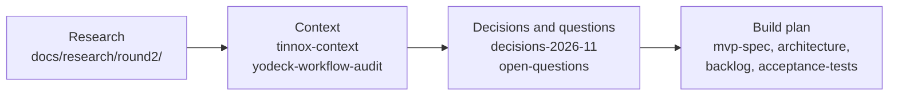

# TINNOX CMS (CMS-RE-Cloud)

TINNOX sells and installs LED walls, outdoor LED signs, pylons, billboards and kiosks across Australia. **TINNOX CMS** is the content management software TINNOX will sell with that hardware: customers upload images, video and PDFs, schedule them, publish them to their screens, and see proof that they are playing. TINNOX staff use the same platform to provision devices, watch the fleet and support customers.

**Where the project is today:** discovery is finished and written up. There is **no code yet**. Everything in this repository is in [`docs/`](docs/): a specification, an architecture, a backlog, acceptance tests, and the research behind them. All of it is dated 3 November 2026 and most of it is **PROPOSED**, meaning it waits for TINNOX to approve or amend it.

---

## Start here: a reading guide

You don't need to read all ~5,800 lines. Read the five documents below in order (about 2 to 3 hours in all). Treat the rest as reference you open only when a question comes up.

| Step | Read | Why | Time |
|---|---|---|---|
| 1 | [`docs/decisions-2026-11.md`](docs/decisions-2026-11.md), all of it | **The one-page summary of the whole project.** It has 29 numbered decisions (DEC-01 to DEC-29), each marked *DECIDED by client* or *PROPOSED for TINNOX approval*, plus recommended answers on support access, hosting cost and player hardware. If you read only one document, read this one. | 30 min |
| 2 | [`docs/open-questions.md`](docs/open-questions.md), sections 2.1 and 6 | **What TINNOX still has to answer (Q13 to Q26), and what happens next.** Q13 (which vendor gave API access) and Q14 (which controller each product package uses) block the controller adapter work and the Huidu hardware order. Platform work can start without them. | 15 min |
| 3 | [`docs/tinnox-mvp-spec.md`](docs/tinnox-mvp-spec.md), sections 1 to 4 | **What release 1 does and does not include**: purpose, the eight product principles, personas and scenarios, and the in-scope and out-of-scope tables. Sections 5 to 20 are detail you can skim. | 30 min |
| 4 | [`docs/implementation-backlog.md`](docs/implementation-backlog.md), sections 0, 2 and 3 | **How it gets built, and in what order.** It covers the first milestone ("one display, one site, honest states"), a 5-phase plan of about 22 weeks for two to three engineers, and the main risks. Section 1 lists the epics (A to N) in detail. | 20 min |
| 5 | [`docs/architecture-and-hardware.md`](docs/architecture-and-hardware.md), sections 1, 2, 5, 6, 7 and 8 | **How it is built and what it runs on**: system topology, how content reaches Huidu and NovaStar LED controllers, the pilot hardware, why we build rather than adapt Xibo, the tech stack, and monthly running costs. | 40 min |

**Then act on it:** [`docs/gaps-and-first-steps.md`](docs/gaps-and-first-steps.md) is a later review (9 November 2026) of the whole pack. It has a checklist for the first two weeks, the security and compliance baseline for a first release, the hardware to prepare, and the inconsistencies found between the documents.

**A quick check worth doing early:** [`docs/tinnox-context.md`](docs/tinnox-context.md) describes TINNOX itself (products, warranty, services, branding) as it was pieced together from tinnox.com.au. You know the business, so you can spot anything wrong here in minutes, and some decisions rest on it. For example, NovaStar became the second controller vendor because the website names it.

### While you review: what to look for

- **DECIDED versus PROPOSED.** Rows marked DECIDED came from TINNOX's answers to Q1 to Q12. Rows marked PROPOSED are recommendations. These are where your judgement matters most.
- **Commercial assumptions:** pricing tiers (DEC-25), plan retention (DEC-19), and "a lapse locks publishing, never playback" (DEC-26).
- **Support access (DEC-17, "B+").** Should TINNOX staff see customer content only when the customer grants access?
- **Hosting (DEC-13).** All customer data stays in Australia, on AWS Sydney with disaster recovery in Melbourne.
- **Hardware (DEC-20, DEC-21)**: Raspberry Pi CM5 boxes for LED walls, RK3588 Android boxes for kiosks, and Huidu cards driven directly for simple signs.
- Anything in the docs that contradicts what you know about TINNOX's products, customers or installed base.

---

## How the documents are organised

The documents fall into four groups. Each group feeds the next.

### 1. Decisions and questions: read first

| Document | What it is | Size |
|---|---|---|
| [`decisions-2026-11.md`](docs/decisions-2026-11.md) | The decision register (DEC-01 to DEC-29), the page TINNOX approves | 94 lines |
| [`open-questions.md`](docs/open-questions.md) | Blockers, questions for TINNOX (Q1 to Q26 with answers so far), assumptions (A-numbers), things that need real hardware, and next actions | 142 lines |
| [`gaps-and-first-steps.md`](docs/gaps-and-first-steps.md) | Review of 9 November 2026: first-two-weeks checklist, launch baseline for security and Australian compliance, what is deferred until a large buyer appears, hardware list, and inconsistencies in the pack | 184 lines |

### 2. Build plan: what we will build

| Document | What it is | Size |
|---|---|---|
| [`tinnox-mvp-spec.md`](docs/tinnox-mvp-spec.md) | The release-1 product specification: scope, workflows for the customer portal and TINNOX operations console, roles, scheduling and time zones, publishing states, player behaviour, media rules, API, commercial hooks | 500 lines |
| [`architecture-and-hardware.md`](docs/architecture-and-hardware.md) | System design, the hardware questionnaire and compatibility matrix, LED integration routes, the pilot hardware, build versus Xibo versus white label, tech stack and running costs | 349 lines |
| [`implementation-backlog.md`](docs/implementation-backlog.md) | Epics A to N with stories, priorities (P0, P1, P2) and sizes, the phase plan, and risks | 206 lines |
| [`acceptance-tests.md`](docs/acceptance-tests.md) | The tests that define "done" for release 1, grouped by area (isolation, provisioning, media, scheduling, publishing, offline, updates, monitoring, Huidu, licensing) | 214 lines |

### 3. Context: background you can consult as needed

| Document | What it is | Size |
|---|---|---|
| [`tinnox-context.md`](docs/tinnox-context.md) | TINNOX's business as read from its website: products, services, branding, what owning software means | 248 lines |
| [`yodeck-workflow-audit.md`](docs/yodeck-workflow-audit.md) | How Yodeck (an existing signage CMS) handles each workflow, from its public help centre and API. **Reference only.** Nothing is copied, and the signed-in Yodeck app was never inspected. It is the longest document; open only the area you care about (section 3.x). | 720 lines |
| [`rea-evaluation.md`](docs/rea-evaluation.md) | Evaluation of REA, a browser-evidence tool. The verdict: not needed, plain Playwright does the job. **Low priority**; you can skip it. | 120 lines |

### 4. Research: the evidence behind the decisions

[`docs/research/round2/`](docs/research/round2/) holds the second round of research. Every claim in the main documents points back to one of these files. You only need them to check where a fact came from.

| File | Topic |
|---|---|
| [R99-critic.md](docs/research/round2/R99-critic.md) | **The summary of round 2**: contradictions found (C1 to C15) and how each was resolved, the edits made to each doc, and what only TINNOX or real hardware can answer. Read this one first among the research files. |
| [R1-huidu-integration.md](docs/research/round2/R1-huidu-integration.md) | Huidu controllers and their HTTP API: how the CMS should talk to them |
| [R2-support-access-models.md](docs/research/round2/R2-support-access-models.md) | How other vendors give support staff access to customer accounts; source of the B+ policy |
| [R3-au-hosting-compliance.md](docs/research/round2/R3-au-hosting-compliance.md) | Australian hosting options, compliance, and the cost model at 10 to 2,000 screens |
| [R4-player-hardware-recommendation.md](docs/research/round2/R4-player-hardware-recommendation.md) | Player hardware choices, including heat in Australian outdoor cabinets |
| [R5-tinnox-site.md](docs/research/round2/R5-tinnox-site.md) | tinnox.com.au read page by page |
| [R6-commercial-model.md](docs/research/round2/R6-commercial-model.md) | CMS pricing in the market, bundling models, and the proposed TINNOX tiers |
| [R7-yodeck-api-spec.md](docs/research/round2/R7-yodeck-api-spec.md) | Yodeck's public API read in full |
| [R8-xibo-verify.md](docs/research/round2/R8-xibo-verify.md) | Fact-check of Xibo (open-source CMS) licensing, pricing and terms |
| [AV1](docs/research/round2/AV1-accounts-admin.md) to [AV5](docs/research/round2/AV5-publish-monitor-offline.md) | Claim-by-claim checks of the Yodeck audit (accounts, registration and API, media and playlists, layouts and scheduling, publishing, monitoring and offline) |

Some files mention a `scratchpad/` folder (for example the round-1 notes `A01` and `T01`). That folder was the research session's temporary workspace and is **not in this repository**.

---

## Decoding the documents

The docs use a few conventions throughout. Once you know them, the documents read much faster.

**Evidence labels.** Each fact says how sure we are of it:

| Label | Means |
|---|---|
| VERIFIED_FULL_PAGE | An official page or spec was read in full |
| OFFICIALLY DOCUMENTED | Official source, but seen only in part or through a search summary |
| THIRD PARTY | Resellers, forums, blogs: lower confidence |
| INFERRED | Our deduction; treat it as a hypothesis |
| UNKNOWN | Searched for and not found |
| HARDWARE-DEPENDENT/UNVERIFIED | Needs testing on the real device |
| PROPOSED | Our recommendation, not a fact |

**IDs you will see:**

| ID | Meaning | Defined in |
|---|---|---|
| DEC-01 to DEC-29 | Decisions | `decisions-2026-11.md` |
| Q1 to Q12 | Questions TINNOX has already answered | `open-questions.md` section 2 |
| Q13 to Q26 | Open questions for TINNOX. **The same questions are also called Q-T1 to Q-T14** (Q-T1 = Q13, Q-T2 = Q14, and so on). | `open-questions.md` section 2.1 |
| A1, A2, … | Assumptions | `open-questions.md` section 4 |
| B1 to B6 | Blockers from the research session | `open-questions.md` section 1 |
| C1 to C15 | Contradictions found and resolved in round 2 | `research/round2/R99-critic.md` |
| Epic A to N, A1, B7, M2 … | Backlog epics and stories | `implementation-backlog.md` |
| PRV-01, MED-02, HUI-05 … | Acceptance tests | `acceptance-tests.md` |
| P0, P1, P2 | Priority: first pilot, first customer release, later | `implementation-backlog.md` |
| R1 to R8, R99, AV1 to AV5 | Research files | `docs/research/round2/` |

**Terms:**
- **Huidu** and **NovaStar**: Chinese makers of LED controllers. These are the boxes that drive an LED screen. Release 1 supports both.
- **"D" card**: a Huidu controller with an engineering ID containing "D". Only these have the HTTP API the CMS can drive directly.
- **Delivery route**: how content reaches a screen. Route (a) is a TINNOX player box feeding the controller over HDMI, the main route. Route (b) pushes programs directly to a Huidu card, the fallback for simple signs.
- **CM5**: Raspberry Pi Compute Module 5, the proposed player for LED walls and pylons.
- **B+**: the proposed support-access policy. Device health is always visible to TINNOX; customer content only with a customer grant.
- **Yodeck** and **Xibo**: existing signage products, studied for reference only.

---

## What happens next

From [`open-questions.md`](docs/open-questions.md) section 6. [`gaps-and-first-steps.md`](docs/gaps-and-first-steps.md) section 2 turns this into a two-week checklist:

1. TINNOX answers Q13 to Q26, Q13 and Q14 first.
2. TINNOX approves or amends the PROPOSED decisions (commercial model, support access, hosting, player hardware).
3. Order the pilot hardware: one Huidu "D" card, one CM5 industrial box, and one RK3588 Android box.
4. Legal review by Australian counsel: privacy obligations, contract terms, and data retention.
5. Start phase 0 of the backlog.
