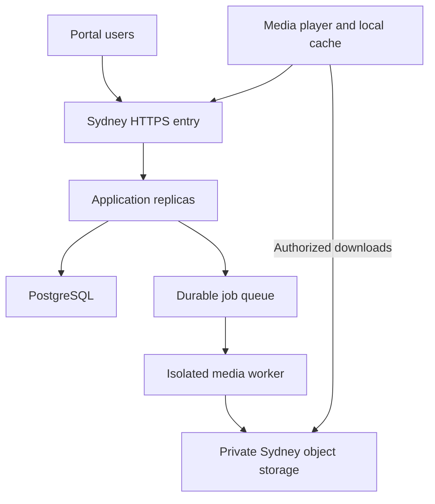

# TINNOX CMS: deployment options and monthly cost estimates

**Prepared:** November 15, 2026  
**Scope:** Australian hosting; 25–1,000 independently connected media players; infrastructure planning only.  
**Currency:** Provider rates are USD. AUD estimates use a **planning assumption of US$1 = A$1.50**, not a live exchange-rate quote. All figures exclude GST.  
**Status:** Estimates, not a vendor quotation or a tested capacity guarantee. No implementation or deployment changes were made for this report.

> **Workload update:** See [Yodeck baseline, proposed customer limits, and revised costs](yodeck-baseline-usage-limits-and-costs-2026-11-15.md) for the subsequent analysis. It replaces the illustrative 5 GiB/player/month workload with explicit content-update scenarios and proposed usage allowances. The original tables below remain available for comparison; their provider rate ledger and deployment tradeoffs still underpin the revision.

## 1. Recommendation and budget

Use **AWS Sydney (`ap-southeast-2`), managed PostgreSQL on RDS, and private S3 object storage** as the default production direction. Keep the existing TypeScript application architecture. A fleet of 1,000 players does not itself justify Kubernetes, microservices, or a different database.

For a supervised pilot, one EC2 application instance and a Single-AZ RDS database are reasonable. Before offering customers an availability commitment, use two application replicas across two availability zones and RDS Multi-AZ. Choose EC2 if the team is comfortable maintaining Linux servers; choose ECS Fargate for the API if reducing host administration is more valuable. In this model their infrastructure bills are very similar.

The modeled media-processing worker remains an isolated, on-demand EC2 worker in all AWS options. This preserves a practical path to the current network-disabled parser container. “Fargate option” therefore means Fargate for the application service, not that every process is serverless.

| Monthly deployment cost | 25 players | 100 players | 500 players | 1,000 players |
|---|---:|---:|---:|---:|
| A. AWS pilot, single instance / Single-AZ DB | US$170 / A$255 | US$233 / A$349 | US$657 / A$985 | US$1,041 / A$1,562 |
| B. AWS EC2, two AZs / Multi-AZ DB | US$416 / A$625 | US$484 / A$726 | US$1,061 / A$1,591 | US$1,478 / A$2,216 |
| C. AWS Fargate, two AZs / Multi-AZ DB | US$415 / A$622 | US$482 / A$723 | US$1,052 / A$1,578 | US$1,483 / A$2,224 |
| D. DigitalOcean Sydney, redundant nodes — conditional | US$374 / A$561 | US$391 / A$586 | US$549 / A$824 | US$643 / A$964 |

Each cell shows **USD / AUD per month**, rounded independently. These are steady-state costs with **5 GiB of media downloaded per player per month** and the **proposed combined 60-second check-in**, not the current two 15-second loops. Sections 5 and 6 show the consequences of those assumptions.

Keeping the current 15-second loops raises option C to at least about **A$759/month at 100 players** and **A$2,585/month at 1,000**, assuming the same provisioned hardware. Additional CPU, database, and log pressure could raise it further.

For the AWS Fargate production option, budget a further 20% for normal variation:

| AWS Fargate planning figure | 25 players | 100 players | 500 players | 1,000 players |
|---|---:|---:|---:|---:|
| AUD/month, including 20% contingency | A$746 | A$868 | A$1,894 | A$2,669 |
| AUD/player/month, before contingency | A$24.87 | A$7.23 | A$3.16 | A$2.22 |

The contingency does not cover a different workload such as continuous video streaming, a second live region, or extensive transcoding. At 1,000 players and 20 GiB downloaded per player, the same AWS architecture rises to about **A$4,550/month before contingency**.

**Decision:** Start with option A for an explicitly limited pilot, or option C immediately if customer-facing availability is required. Keep option B as an equally credible choice for a team that prefers EC2. Investigate option D only after resolving its database lifecycle and residency questions; its lower price is not evidence of equivalent resilience or operational effort.

## 2. What each component does

| Component | Responsibility | What drives its cost |
|---|---|---|
| Portal and API on EC2 or Fargate | Login flows, tenant authorization, content management, publishing, pairing, manifests, and player status | Provisioned CPU/memory, instance/task count, request processing |
| PostgreSQL on RDS | Organizations, users/roles, media metadata, playlists, publications, device credentials, status, and audit records | Database size/class, Multi-AZ replication, storage, backups |
| S3 | Video/image bytes, thumbnails, and retained object versions | Stored bytes, download bytes, object requests |
| Application Load Balancer (ALB) | HTTPS entry point, health checks, routing to healthy application replicas | Running hours and measured capacity units |
| Durable job queue and isolated worker | Media validation and thumbnails; retry failed work without blocking the API | Worker runtime, queue operations, temporary disk |
| Cognito in Sydney, proposed | Managed identity for human portal users, replacing the development identity service | Monthly active humans, selected identity features, email/SMS |
| Monitoring and backups | Detect failures, investigate incidents, restore data | Log ingestion/retention, metrics, snapshots, recovery exercises |
| Player cache | Retains the playlist and media locally so playback can continue through an internet outage | Player storage; cloud downloads only when content is needed |

**PostgreSQL is the database software; RDS is AWS's managed service for running it. S3 is object storage, not the application's relational database.** A video belongs in S3; its owner, title, checksum, and playlist relationships belong in PostgreSQL. PostgreSQL is open source. The current repository already uses PostgreSQL and tenant row-level security.

Players initiate outbound HTTPS connections to the API and authorized media downloads from object storage. Customer sites do not need inbound firewall ports opened for normal operation. A screen does not necessarily equal one connection: ten panels driven by one player can be one endpoint; ten independently scheduled players are ten endpoints. The model counts **players**.



Linux, Android, or a browser-based player can use the same versioned HTTPS protocol. Cloud costs depend more on connection behavior, media size, caching, and telemetry than on the player's operating system. This hosting decision does not commit TINNOX to one hardware brand.

## 3. Workload assumptions

These assumptions are deliberately explicit so the estimate can be recalculated after the pilot.

| Input | 25 players | 100 players | 500 players | 1,000 players |
|---|---:|---:|---:|---:|
| Illustrative customers × players each | 5 × 5 | 10 × 10 | 10 × 50 | 10 × 100 |
| Active portal users, two per customer | 10 | 20 | 20 | 20 |
| Unique active media library | 50 GiB | 100 GiB | 250 GiB | 500 GiB |
| Billed media storage, including 20% retained versions/renditions | 60 GiB | 120 GiB | 300 GiB | 600 GiB |
| Media downloaded by the fleet/month | 125 GiB | 500 GiB | 2,500 GiB | 5,000 GiB |
| Provisioned database storage | 30 GiB | 50 GiB | 100 GiB | 200 GiB |
| Media worker runtime/month | 40 hours | 80 hours | 200 hours | 400 hours |
| Portal/administrative internet egress/month | 10 GiB | 20 GiB | 50 GiB | 100 GiB |
| Application logs ingested/month | 5 GiB | 10 GiB | 25 GiB | 50 GiB |

- Compute uses 730 hours/month. Traffic uses 30 days: 2,592,000 seconds. The small difference is intentional: a standard pricing month versus a reproducible traffic scenario.
- All players are online 24/7. The baseline is one combined check-in every 60 seconds, with full manifests fetched when their version changes.
- Control egress assumes an average 1 KiB outbound per exchange, plus 25% headroom for protocol overhead and incidental control traffic. Incoming requests are additional network traffic but are not internet egress. Actual headers, connection reuse, payloads, and retries must be measured.
- WAF request estimates add 10% to baseline check-ins for incidental API requests. This is a budget assumption, not a measured upper bound. Frequent browser CORS preflights or event reports could exceed it.
- Media is downloaded and cached, not streamed repeatedly. The 5 GiB allowance is per player, even when many players show identical content. Object storage does not eliminate those separate downloads.
- Worker hours cover inspection and thumbnails, not continuous transcoding or arbitrary HTML rendering. The estimate assumes workers stop when the queue is empty; an always-running worker costs more.
- Normal logs are sampled/aggregated with roughly 30-day retention; errors and security events remain usable. The model does not ingest full request bodies or one verbose log per check-in.
- No promotional credits, committed-use discounts, or Spot discounts are assumed. AWS's shared 100 GB/month free internet egress is conservatively not deducted because another workload may consume it. If fully available, it reduces most baseline AWS totals by about US$11.40/month. [S8]
- Cognito Essentials for the small number of directly authenticated human users is assumed to remain within its recurring free MAU allowance. Players use application device credentials, **not a new paid Cognito machine-to-machine token request for every heartbeat**. Email is included in a small-services allowance; paid SMS is excluded. [S9]
- Vendor “GB” billing units are approximated with GiB workload inputs. This is a planning model, not a byte-for-byte invoice forecast.

## 4. Deployment options and tradeoffs

### A. AWS pilot: one EC2 application instance, Single-AZ RDS, S3

Run the portal/static player assets and API behind HTTPS on one EC2 instance. Place the database in private networking. Use S3 for durable media and a separate isolated worker. The application instance has a public IPv4 address; only the HTTPS entry point is publicly exposed. No ALB or NAT Gateway is budgeted in this option.

**Advantages:** Lowest AWS fixed cost; straightforward deployment; managed database and durable media from the start. Moving to a redundant service later does not require changing database technology.

**Limitations:** Application or database failure interrupts cloud management until recovery. Deployment may interrupt the API. This option has no separately budgeted managed WAF. Cached players should keep playing, but publishing and cloud visibility can be unavailable. The 500/1,000-player columns illustrate cost, not a recommendation to leave a large paying fleet on one application server.

### B. AWS production: two EC2 replicas, Multi-AZ RDS, S3

Run two application instances across two Sydney availability zones behind an ALB. Use an Auto Scaling Group for replacement, private application subnets, one NAT Gateway per AZ, and an S3 gateway endpoint. Use a durable queue and retryable worker jobs.

**Advantages:** Familiar Linux/container deployment; control over host hardening and runtime; explicit AZ separation; predictable baseline price.

**Limitations:** TINNOX maintains server patching, images, deployment automation, and capacity. Burstable instances require CPU-credit monitoring. Two replicas are only useful if either survivor can carry the expected load during a failure; that has not been benchmarked.

RDS Multi-AZ here means a primary plus a **single standby for failover**, not a readable replica or the three-instance Multi-AZ cluster product. Do not count the standby as extra query capacity. Applications still need connection retries during failover. [S10]

### C. AWS production: two Fargate application tasks, Multi-AZ RDS, S3

Use an ECS service with a minimum of two API tasks across two AZs, behind the same ALB. Serve the small portal/player web bundles through the application ingress; this model does not depend on a global CDN. Keep the isolated, intermittent worker on EC2 initially.

**Advantages:** AWS manages application hosts; health-based replacement and rolling deployments are convenient. Scaling application tasks does not require maintaining a fleet of API servers.

**Limitations:** Container definitions, IAM, networking, migrations, and observability still require engineering. The separate worker retains some server administration. Private networking has a material fixed cost. Fargate task replicas do not fix state stored on local disks.

This is my preferred production option **if the team is comfortable with ECS**. Its modeled price is close enough to B that operations, not a few dollars of compute, should decide.

The two NAT Gateways are a conservative networking choice, not a requirement imposed by Australian residency. An alternative is publicly addressed application tasks with security groups allowing inbound application traffic only from the ALB, while keeping RDS private. That can remove roughly US$86/month of fixed NAT charges, with public-address and routing costs recalculated. It needs an explicit network-security design; the baseline retains private application subnets for a consistent comparison.

### D. DigitalOcean Sydney: redundant app Droplets, managed PostgreSQL, Spaces

Model two application Droplets behind a regional HTTP load balancer, a two-node PostgreSQL Advanced Edition cluster, a temporary worker Droplet, and private Spaces storage in `SYD1`. For consistent identity assumptions, this option also uses Cognito in AWS Sydney; it therefore spans two providers. Self-hosting Keycloak instead would need its own sizing and operational budget.

**Advantages:** Simpler infrastructure surface and substantially cheaper modeled media egress. Spaces includes 1 TiB/month of outbound transfer, with overage at US$0.01/GiB. At larger media volumes this matters much more than a small VM-price difference. [S13]

**Limitations and gates:** Do not treat this as an approved production equivalent to AWS Multi-AZ. Current DigitalOcean API documentation describes Advanced Edition as **public preview**; the lifecycle policy says previews are not backed by SLA credits and recommends against sensitive production workloads. Confirm general availability and contractual coverage before selection. [S16, S17]

New Standard Edition cluster restrictions also make historical “US$30 primary + US$30 standby” estimates unsuitable for a new account. The model uses the published US$130 Advanced primary plus matching standby. Restrictions begin October 15, 2026 for new accounts and November 30 for all accounts creating new clusters. [S12]

Confirm the exact Advanced Edition SKU is orderable in Sydney, its storage inclusions, replica failure-domain placement, and the location of managed backups and operational copies. The general PostgreSQL availability table lists Sydney, but does not settle all those questions. Do not infer AWS-style separate AZ guarantees from two nodes in one DigitalOcean region. [S15]

No managed application WAF is priced for D. Local reverse-proxy protections and application rate limits require implementation and maintenance; they are not the same managed service as AWS WAF. This and the database uncertainty are material differences in the comparison.

### Other options considered

| Option | Assessment for this project |
|---|---|
| PostgreSQL and the app on one inexpensive VPS | Suitable for disposable development. Cheaper invoices transfer backup, patching, failover, and recovery responsibility to TINNOX; not the customer-facing recommendation. |
| Lambda/API Gateway | Potentially useful for intermittent endpoints or background jobs. The existing Fastify/database lifecycle would need deployment work, and per-request charges still matter at tens or hundreds of millions of requests. Not assumed cheaper without its own benchmark/model. |
| AWS Lightsail | Could simplify a pilot, but a production design still needs a deliberate database, backup, scaling, and residency plan. Not needed as an extra migration step here. |
| Azure or Google Cloud in Australia | Credible alternatives if the team already has expertise or a commercial agreement. Not priced in this report; no claim that they are inherently more expensive. |
| Kubernetes/EKS | No demonstrated need at this scale; adds platform work and another cost center. |
| MongoDB | No identified workload benefit that offsets replacing the existing relational schema, transactions, and PostgreSQL RLS. |
| Snowflake | A separate analytics decision if large historical reporting becomes necessary; not a replacement for the CMS's transactional database or media object store. |

## 5. Player communication: what it costs and what should change

A **manifest** is a versioned playback plan: which media to use, in what order, with timing/layout information and asset identifiers. A **manifest poll** asks whether that plan has changed. A **heartbeat** reports that a player is connected and what it is doing. Neither should upload or download the entire media library.

The current repository defaults to a manifest check every 15 seconds and heartbeat every 15 seconds. The heartbeat reply already carries `desiredPublicationId`, and the player can use that hint to trigger synchronization. That provides a sensible starting point for a future combined check-in; it is not already a completed optimization.

| Protocol at 1,000 online players | Current: two calls every 15 seconds | Proposed: one call every 60 seconds |
|---|---:|---:|
| Baseline requests/month | 345,600,000 | 43,200,000 |
| Average requests/second | 133.3 | 16.7 |
| Control egress, GiB/month | 411.99 | 51.50 |
| Control egress at $0.114/GiB | $46.97 | $5.87 |
| WAF request charges, including 10% extra requests | $228.10 | $28.51 |
| C: total USD/month, same provisioned hardware | $1,723.55 | $1,482.87 |

These are control-plane requests, **not S3 GETs**. EC2/Fargate do not bill a separate flat fee for every HTTP request; charges emerge through CPU, network, load-balancer utilization, WAF, logging, and database work. S3 charges apply when an object is actually requested.

The last row changes only modeled control egress and WAF request charges. It is a **lower-bound cost comparison with fixed hardware**, not a capacity claim. Higher request rates may need more CPU, additional ALB capacity, database tuning, and more logging budget. A 304/not-modified response reduces response bytes; it does not remove the request, authentication, or WAF evaluation.

Recommended initial production behavior:

1. Send one authenticated status/check-in approximately every 60 seconds, randomized across players.
2. Include the desired manifest version in the response. Fetch the full manifest only when needed, plus a slower recovery check.
3. Report important transitions promptly: download complete, activation, playback failure, and recovery. Do not send a new network report for every frame or progress tick.
4. Use local scheduling and cached assets. Changing from 15 to 60 seconds need not reduce playback smoothness or the accuracy of an already downloaded schedule; it increases new-publication discovery latency to roughly a minute plus download time.
5. Mark status stale after several missed check-ins, for example 3–5 minutes. Change the existing stale threshold with the interval so healthy players do not appear offline.
6. Use exponential retry backoff with jitter after failures. On reconnect, spread manifest checks and media downloads rather than having the whole fleet retry simultaneously.

If instant commands become a product requirement, add WebSocket/MQTT notifications to prompt synchronization, with periodic reconciliation as a fallback. Do not add a persistent-connection platform solely to avoid a modest polling bill. Its connections, reconnects, message delivery, and operations also have costs.

The database deserves attention even when the network bill is small. At 1,000 players, one accepted heartbeat every 15 seconds produces 5.76 million reports/day; every 60 seconds produces 1.44 million. The current 10-second history sampling threshold does not reduce a steady 15-second stream. The repository currently retains raw heartbeat history for 24 hours. Indexes, WAL, deletion/vacuum work, and status updates matter beyond the raw JSON size. Keep short diagnostic history and aggregate longer-term statistics; validate this under load.

Yodeck publicly describes an ongoing control connection and local caching, with static media downloaded once unless it changes. Its bandwidth guide estimates up to 300 MB/player/month for server communication, excluding media downloads and other traffic. This supports the general cached-player design, but **does not establish Yodeck's private protocol or exact polling interval**. TINNOX's smaller illustrative payload budget must be measured, not treated as a Yodeck-equivalent guarantee. [S18]

## 6. Media delivery is the larger variable

The following holds compute, storage, worker runtime, and all other assumptions constant while changing downloaded media at 1,000 players:

| Downloaded media per player/month | Fleet media at 1,000 players | AWS media-only transfer, USD | C: total USD / AUD | D: total USD / AUD |
|---|---:|---:|---:|---:|
| 1 GiB | 1,000 GiB | $114.00 | $1,027 / A$1,540 | $603 / A$904 |
| 5 GiB | 5,000 GiB | $570.00 | $1,483 / A$2,224 | $643 / A$964 |
| 20 GiB | 20,000 GiB | $2,123.84 | $3,034 / A$4,551 | $793 / A$1,189 |

AWS media-only transfer uses US$0.114/GB for the first 10,240 GB and US$0.098/GB for the next tier. The total also includes control and administrative egress, so its marginal difference can cross a tier boundary. [S5]

A 500 MiB video sent once to 100 players is about 48.8 GiB delivered, roughly **US$5.57** at the first AWS tier. Replaying that cached video all month need not download it again. Replacing it every day does.

Separately budget the **initial cache fill**. Loading 10 GiB onto each of 1,000 new players adds 10,000 GiB of delivery. On top of the baseline 5,000 GiB media month and other egress, that adds approximately **US$1,061 / A$1,592** in AWS transfer. This onboarding burst is not in the steady-state totals. Cache wipes, device replacement, and changing asset URLs without stable content hashes can repeat it.

Useful controls are per-tenant storage/download quotas, content hashes, immutable asset identifiers, retained-version expiry, resumable downloads, retry limits, and fleet-wide rollout throttling. If customers request live streams or many screenshot uploads, model those separately. Those features can change both bandwidth and processing costs substantially.

## 7. Detailed sizing and costs

### Proposed resource sizes

| Resource | 25 / 100 players | 500 players | 1,000 players |
|---|---|---|---|
| A: one EC2 app instance | `t4g.medium`, 2 vCPU / 4 GiB | `c7g.large`, 2 vCPU / 4 GiB | `m7g.large`, 2 vCPU / 8 GiB |
| B: two EC2 app instances | 2 × `t4g.medium` | 2 × `c7g.large` | 2 × `m7g.large` |
| C: two ARM Fargate tasks | Each 1 vCPU / 2 GiB | Each 2 vCPU / 4 GiB | Each 2 vCPU / 8 GiB |
| AWS database | `db.t4g.medium`, 2 vCPU / 4 GiB | `db.m7g.large`, 2 vCPU / 8 GiB | `db.m7g.large`, 2 vCPU / 8 GiB |
| D: two app Droplets | Each regular 2 vCPU / 4 GiB | Each general-purpose 2 vCPU / 8 GiB | Each general-purpose 2 vCPU / 8 GiB |
| D: database | 2 × Advanced 2 vCPU / 8 GiB, conditional | Same initial sizing | Same initial sizing |

These are starting envelopes, not equivalent benchmarked CPUs. AWS T-series and regular Droplets are shared/burstable; dedicated/general-purpose choices have different performance characteristics. ARM images and native dependencies must be validated, including the media worker. Fargate x86 rates are higher; this model uses ARM rates explicitly.

### Itemized monthly estimates

| Monthly cost, USD | A: 100 | B: 100 | C: 100 | D: 100 | C: 1,000 | D: 1,000 |
|---|---:|---:|---:|---:|---:|---:|
| Application compute | 30.95 | 61.90 | 69.16 | 48.00 | 163.20 | 126.00 |
| App disks and snapshots | 4.53 | 9.06 | 0.00 | 14.40 | 0.00 | 37.80 |
| Database compute | 74.46 | 148.19 | 148.19 | 260.00 | 341.64 | 260.00 |
| Database storage and backup reserve | 11.65 | 18.55 | 18.55 | 11.50 | 74.20 | 46.00 |
| Media worker | 10.83 | 10.43 | 10.43 | 5.00 | 40.64 | 25.00 |
| Load balancer | 0.00 | 24.24 | 24.24 | 12.00 | 24.24 | 12.00 |
| NAT and public IPv4 | 3.65 | 101.92 | 101.92 | 0.00 | 101.92 | 0.00 |
| Object storage and requests | 3.02 | 3.02 | 3.02 | 5.00 | 15.10 | 16.00 |
| Internet delivery | 59.87 | 59.87 | 59.87 | 0.00 | 587.27 | 39.76 |
| Monitoring and other services | 34.03 | 34.03 | 34.03 | 35.00 | 96.15 | 80.00 |
| Managed WAF | 0.00 | 12.85 | 12.85 | 0.00 | 38.51 | 0.00 |
| **Total** | **232.99** | **484.06** | **482.26** | **390.90** | **1,482.87** | **642.56** |

Totals use unrounded inputs, so rounded line items may differ by a cent.

### What is inside those lines

- **App disks/snapshots:** EC2 has 30 GiB gp3 plus 30 GiB of billed snapshot storage per application instance. Fargate uses included task ephemeral storage and no durable local app disk. DigitalOcean boot disks are included; the line budgets daily Droplet backups at 30% of application VM price. [S1, S11, S19]
- **Database:** A uses Single-AZ; B/C use Multi-AZ prices already inclusive of the standby—do not multiply the listed Multi-AZ compute rate by two again. AWS backup reserve assumes an additional billable volume equal to the allocated database storage, beyond the included allowance; actual changed-block retention may differ. No additional provisioned IOPS or T-series surplus CPU credits are priced.
- **DigitalOcean database storage:** Conservatively budgets the full allocated storage at US$0.115/GiB for each of two nodes, on top of node prices, pending confirmation of included storage. An additional database-sized logical-backup reserve is included in Spaces storage. This is not a guarantee that all backups fit that reserve or that managed backup residency has been verified.
- **Worker:** AWS uses an intermittent `c7g.large` plus a conservative 30 GiB-month gp3 allowance. The pilot includes a public IPv4 charge during worker runtime; production workers use the private network. DigitalOcean uses a CPU-optimized 2 vCPU / 4 GiB Droplet at US$0.0625/hour, destroyed/stopped from billing when no longer required. Simply shutting down a billed Droplet is not the assumed saving. Worker runtime includes staging/idle time; no sustained transcoding is included.
- **ALB:** B/C budget 730 hours and one average LCU. AWS bills the dominant capacity dimension, including connection churn, processed bytes, and rule evaluation. One LCU is a modeling assumption. Direct object downloads keep large media bodies out of the ALB. [S7]
- **Networking:** B/C include two NAT Gateways, 20 GB total NAT-processed non-media traffic, and four public IPv4 addresses: two for the ALB and two for NAT. NAT alone costs US$86.14/month before traffic. Use an S3 gateway endpoint; do not route worker media traffic through NAT. Avoid duplicating paid interface endpoints unless required; those are not in the base total. Additional ALB addresses or NAT traffic cost extra. [S1, S6]
- **S3 requests:** Assume 100 media GETs/player/month plus 10,000 other GETs, and respectively 1,000/2,000/5,000/10,000 PUTs across the four fleet sizes. At this workload, request charges are small. Large counts of tiny media objects need a different request model.
- **AWS observability:** Log ingestion at US$0.67/GB plus US$0.033/GB-month retained storage, budgeting a full month's ingestion volume as retained. Add 20/20/40/60 custom metrics at US$0.30 and 10/10/20/30 standard alarms at US$0.10. [S4]
- **Small AWS services allowance:** US$15/20/30/40 per month within the monitoring line, including a small allowance for cross-AZ application traffic, DNS, registry storage, secrets/encryption requests, email, and queue/scheduler operations. This is an explicit planning allowance, not a priced bill of materials. SQS standard requests are US$0.40/million before its shared free allowance. [S20]
- **WAF:** B/C include one US$5 web ACL, five US$1 rules, and US$0.60 per million inspected requests, with the 10% extra-request allowance. Premium managed rules, CAPTCHA, Bot Control, and attack-induced traffic are not included. [S21]
- **DigitalOcean monitoring/other allowance:** US$25/35/55/80 for regional logging, monitoring/storage, DNS, registry, and ancillary services. Application/control egress is assumed to fit the Droplet transfer allowance. Media is delivered directly from Spaces, whose transfer allowance is separate. Do not offset Spaces overage with unused Droplet transfer. [S11, S13]
- **Identity:** Same Sydney Cognito assumption for all options; no separate Keycloak servers in these totals. This is a proposed production integration, not an assertion that the current development identity configuration is production-ready.

## 8. Australian residency and availability boundaries

The estimate assumes customer application data, media, databases, backups, encryption keys, and retained operational logs are configured in Australian regions. This is an architectural requirement to validate, **not a blanket compliance certification**.

For AWS, start with Sydney for RDS, S3, ECS/EC2, regional queues, logs, registry, and Cognito. Check optional identity integrations, email delivery, analytics, third-party monitoring, crash reports, and support workflows individually. Regional Cognito storage does not imply every optional integration remains in that region. [S22]

Do not enable global CloudFront or the global Spaces CDN by default under a strict Australia-only storage/processing interpretation. A Sydney origin does not keep globally cached copies in Australia. CloudFront price classes are not an Australia-only residency control. Direct private Sydney storage is the costed baseline. DNS/global service metadata and public website assets need their own explicit policy scope. [S23]

Multi-AZ protects against some local infrastructure failures; it is not a second-region disaster recovery plan. A Sydney region outage can still interrupt cloud management. Cached playback can continue where the player, display, power, and local media remain healthy, but it is not a substitute for database recovery.

If Australian regional disaster recovery is required, price Melbourne backup copies or a standby deployment separately. Include replication transfer, duplicate storage, restoration tests, and any standby compute; do not assume the second region is free. Define recovery-time and recovery-point targets before buying it.

For DigitalOcean, obtain explicit answers on Advanced Edition production support, the exact Sydney plan, backup residency, replica placement, and operational data handling. Until resolved, option D is a cost comparison and procurement candidate, not an unconditional recommendation.

## 9. Current implementation versus the costed architecture

This is a read-only deployment review of the files visible on November 15. The repository is actively changing, so these are implementation observations to recheck before deployment.

| Observed area | Deployment consequence / required future work |
|---|---|
| `apps/api/src/main.ts` constructs `LocalObjectStorage` | Implement and test private S3-compatible storage before independent replicas or ephemeral application tasks. A local folder is not shared durable storage. |
| Media pipeline uses a job directory; parser worker is separately isolated | Replace host-local dispatch with durable jobs and explicit staging/results. Preserve parser isolation. Ensure retries and duplicate delivery are safe; SQS standard delivery can repeat a job. [S24] |
| API startup runs media polling and housekeeping | Make background execution coordinated/idempotent. Starting a second API must not create unsafe competing cleanup or job execution. |
| Player media URL handling checks the API origin | Direct S3/Spaces downloads need a deliberate client security/CORS change, signed URL validation, and cache behavior tests. Do not forward the device bearer token to object storage. |
| Current device protocol has independent 15-second loops | The baseline estimate assumes a future combined 60-second check-in. The current configuration costs more; section 5 quantifies a lower-bound difference. |
| In-process throttling/auth-failure tracking | Enforce fleet-wide limits through a shared mechanism or edge controls. PostgreSQL-backed bounded counters may suffice initially; add Valkey only if measurements justify it. No dedicated cache cluster is priced here. |
| Database pool maximum is 15 per API process | Two replicas mean up to 30 API connections, plus workers/migrations. Set a fleet-wide connection budget before autoscaling. |
| PostgreSQL RLS and database-backed application state are present | Preserve tenant isolation through managed hosting and failover; migration/admin roles must not become the normal application role. |
| Development OIDC provider/configuration | Validate Cognito integration, callbacks, MFA, session behavior, and region settings. Alternatively budget and operate production Keycloak explicitly. |

These are reasons not to deploy the current checkout unchanged onto two servers and assume it is highly available. They do **not** call for changing the programming language or splitting the application into many services.

## 10. Exclusions, uncertainty, and next steps

Not included: engineering and on-call labor; player hardware or licenses; customer broadband/SIM data; domain registration; GST; paid cloud support; penetration testing/compliance assessments; a full staging environment; multi-region recovery; premium security products; extensive SMS; full media transcoding; unusual audit retention; and sustained attack traffic.

Infrastructure savings should be compared with staff time. A cheaper provider can lose its advantage if it adds manual recovery work. Conversely, managed AWS infrastructure does not eliminate application incidents or the need for restore drills.

At the assumed exchange rate, the AWS Fargate 1,000-player baseline is about A$2,224/month. If US$1 instead costs A$1.40–A$1.65, the same US-dollar bill becomes approximately **A$2,076–A$2,447**, before contingency/GST. At 20 GiB/player, the media scenario changes the budget much more than this FX range.

Recommended next work, after choosing a pilot target:

1. **Measure the workload:** actual video/image sizes, replacements per week, first-install cache size, screenshot requirements, expected player count, and offline duration.
2. **Build deployment prerequisites:** regional object storage, durable worker dispatch, stateless API replicas, production identity, shared limits, signed download delivery, and the chosen check-in cadence.
3. **Run a representative fleet test:** 100 then 1,000 simulated players, real database queries, normal media publications, a reconnect burst, one-replica failure, and database failover. Measure p95 latency, CPU, DB connections/WAL, ALB LCUs, and bytes/player/day.
4. **Test on real target hardware:** prove cache persistence after reboot, unattended restart, storage exhaustion behavior, codec support, and long-running playback. A browser simulation is not a hardware acceptance test.
5. **Set billing controls:** budget alerts at 50%, 80%, and 100% of the chosen monthly allowance; per-tenant transfer visibility; media retention limits; queue concurrency limits; and explicit log retention. Budget alerts do not automatically cap spending.
6. **Reprice from evidence:** replace the assumptions with two weeks of measurements and approve the resulting availability target before committing customers to an SLA.

No infrastructure was provisioned, no paid action was taken, and no implementation files were modified for this analysis.

## Appendix A. Calculation rules and checked unit rates

All prices below are USD, on-demand/list rates checked November 15, 2026. Official AWS regional price-list JSON was downloaded and inspected; publication dates ranged from November 4–14. Use the regional SKU values rather than US-region examples embedded in general pricing pages.

| Item | Rate used | Source |
|---|---:|---|
| EC2 `t4g.medium` / `c7g.large` / `m7g.large`, Linux shared tenancy | $0.0424 / $0.0944 / $0.102 per hour | S1 |
| EBS gp3 / snapshot storage | $0.096 / $0.055 per GB-month | S1 |
| NAT Gateway | $0.059/hour + $0.059/GB processed | S1 |
| Public IPv4 | $0.005/address-hour | S6 |
| Fargate ARM vCPU / RAM | $0.03885/vCPU-hour + $0.00426/GiB-hour | S2 |
| Fargate x86 vCPU / RAM, comparison only | $0.04856/vCPU-hour + $0.00532/GiB-hour | S2 |
| RDS PostgreSQL `db.t4g.medium`, Single-AZ / Multi-AZ | $0.102 / $0.203 per hour | S3 |
| RDS PostgreSQL `db.m7g.large`, Single-AZ / Multi-AZ | $0.234 / $0.468 per hour | S3 |
| RDS gp3, Single-AZ / Multi-AZ | $0.138 / $0.276 per GB-month | S3 |
| RDS excess backup storage | $0.095/GB-month | S3 |
| S3 Standard storage, first 50 TB | $0.025/GB-month | S25 |
| S3 PUT / GET | $0.0055 / $0.00044 per 1,000 requests | S25 |
| Sydney internet egress, first 10 TB / next 40 TB | $0.114 / $0.098 per GB | S5 |
| Sydney ALB / LCU | $0.0252/hour + $0.008/LCU-hour | S26 |
| CloudWatch log ingest / retained storage | $0.67/GB + $0.033/GB-month | S4 |
| CloudWatch custom metric / standard alarm | $0.30 / $0.10 per month, first metric tier | S4 |
| SQS standard requests | $0.40/million before shared free allowance | S20 |
| WAF ACL / rule / inspected requests | $5/month / $1/month / $0.60 per million | S21 |
| DigitalOcean regular 2 vCPU / 4 GiB app | $24/month | S11 |
| DigitalOcean general-purpose 2 vCPU / 8 GiB app | $63/month | S11 |
| DigitalOcean CPU-optimized 2 vCPU / 4 GiB worker | $0.0625/hour; $42 monthly cap | S11 |
| DigitalOcean Advanced PostgreSQL 2 vCPU / 8 GiB | $130/month per node, conditional eligibility | S12 |
| DigitalOcean Advanced additional DB storage | $0.115/GiB-month per node budgeted | S12, S27 |
| DigitalOcean regional HTTP load balancer | $12/month per node | S14 |
| Spaces base | $5/month including 250 GiB storage and 1,024 GiB outbound | S13 |
| Spaces extra storage / transfer | $0.02 / $0.01 per GiB | S13 |

DigitalOcean always-on Droplets use the listed monthly price, not 730 multiplied by the hourly rate; its monthly cap differs from AWS's usual 730-hour estimating convention.

Reproduction formulas, with `N` players, `M` GiB media downloaded/player/month, `D` provisioned DB GiB, and `H` worker hours:

```text
Monthly check-ins = N × 30 × 24 × 3,600 / 60
Current two-loop requests = N × 30 × 24 × 3,600 × (1/15 + 1/15)
Control egress GiB = monthly requests × 1.25 / 1,048,576
AWS total egress GiB = N × M + control egress + administrative egress
AWS egress cost = min(total, 10,240) × 0.114
                 + max(total - 10,240, 0) × 0.098
                 [sufficient for all scenarios in this report]

Two Fargate tasks = 2 × 730 × (vCPU per task × 0.03885
                             + GiB RAM per task × 0.00426)
AWS worker = H × 0.0944 + 30 × 0.096
             [pilot additionally pays H × 0.005 for worker IPv4]
RDS = 730 × selected instance rate + D × selected gp3 rate + D × 0.095
Production NAT/IP = 2 × 730 × 0.059 + 20 × 0.059 + 4 × 730 × 0.005
ALB = 730 × (0.0252 + 1 × 0.008)
WAF = 5 + 5 × 1 + monthly requests × 1.10 / 1,000,000 × 0.60

Spaces = 5 + max(media storage + DB backup reserve - 250, 0) × 0.02
           + max(N × M - 1,024, 0) × 0.01
DigitalOcean DB = 2 × 130 + 2 × D × 0.115 [conservative storage assumption]
AUD estimate = USD total × 1.50
AUD planning budget = USD total × 1.50 × 1.20
```

Selected AWS audit identifiers: EC2 `t4g.medium` SKU `9TP3ARTXQ46KEGHK`; NAT hours `NUKV5QPTHVFBW7DE`; RDS `db.t4g.medium` Multi-AZ `SB3H4H2CHGW7C77R`; RDS `db.m7g.large` Multi-AZ `8MF49ZBGQ3XD2B3S`; ordinary Sydney internet egress `KRXM4TG87VW2NPHA`; S3 Standard storage `5QVJMK36NJC9G6DC`; ALB hours `M84CYHYUVJ4USFHD`. Special transfer products and readable-standby database clusters were not substituted for these rates.

## Appendix B. Sources and repository evidence

All external sources below were consulted November 15, 2026. Pricing pages can change; rates and workload inputs are reproduced above so the estimate remains reviewable. This report updates the deployment-cost assumptions for this decision; older research estimates in the repository have not been edited.

- **S1:** [AWS EC2 Sydney regional price list](https://pricing.us-east-1.amazonaws.com/offers/v1.0/aws/AmazonEC2/current/ap-southeast-2/index.json), published November 14, 2026.
- **S2:** [AWS ECS/Fargate Sydney regional price list](https://pricing.us-east-1.amazonaws.com/offers/v1.0/aws/AmazonECS/current/ap-southeast-2/index.json), published November 11, 2026; [Fargate pricing explanation](https://aws.amazon.com/fargate/pricing/).
- **S3:** [AWS RDS Sydney regional price list](https://pricing.us-east-1.amazonaws.com/offers/v1.0/aws/AmazonRDS/current/ap-southeast-2/index.json), published November 13, 2026.
- **S4:** [CloudWatch Sydney regional price list](https://pricing.us-east-1.amazonaws.com/offers/v1.0/aws/AmazonCloudWatch/current/ap-southeast-2/index.json), published November 4, 2026.
- **S5:** [AWS Data Transfer Sydney regional price list](https://pricing.us-east-1.amazonaws.com/offers/v1.0/aws/AWSDataTransfer/current/ap-southeast-2/index.json), published November 11, 2026.
- **S6:** [AWS VPC and public IPv4 pricing](https://aws.amazon.com/vpc/pricing/).
- **S7:** [AWS Elastic Load Balancing pricing and LCU dimensions](https://aws.amazon.com/elasticloadbalancing/pricing/).
- **S8:** [EC2 on-demand pricing and shared free internet egress](https://aws.amazon.com/ec2/pricing/on-demand/).
- **S9:** [Cognito pricing](https://aws.amazon.com/cognito/pricing/).
- **S10:** [RDS Multi-AZ DB instance deployments](https://docs.aws.amazon.com/AmazonRDS/latest/UserGuide/Concepts.MultiAZSingleStandby.html).
- **S11:** [DigitalOcean Droplet prices](https://www.digitalocean.com/pricing/droplets).
- **S12:** [DigitalOcean PostgreSQL pricing](https://docs.digitalocean.com/products/databases/postgresql/details/pricing/); [2026 database plan changes](https://docs.digitalocean.com/release-notes/upcoming/dbaas-plan-changes/).
- **S13:** [DigitalOcean Spaces pricing](https://docs.digitalocean.com/products/spaces/details/pricing/).
- **S14:** [DigitalOcean load balancer pricing](https://docs.digitalocean.com/products/networking/load-balancers/details/pricing/).
- **S15:** [DigitalOcean PostgreSQL regional availability](https://docs.digitalocean.com/products/databases/postgresql/details/availability/); [Spaces availability](https://docs.digitalocean.com/products/spaces/details/availability/).
- **S16:** [DigitalOcean PostgreSQL API documentation: Advanced Edition preview status](https://docs.digitalocean.com/products/databases/postgresql/reference/api/); [Advanced Edition architecture](https://docs.digitalocean.com/products/databases/postgresql/concepts/advanced-edition/).
- **S17:** [DigitalOcean product lifecycle stages](https://docs.digitalocean.com/platform/product-lifecycle/).
- **S18:** [Yodeck bandwidth guidance](https://www.yodeck.com/docs/user-manual/how-much-bandwidth-does-yodeck-use/).
- **S19:** [DigitalOcean backup pricing](https://docs.digitalocean.com/products/backups/details/pricing/).
- **S20:** [SQS Sydney regional price list](https://pricing.us-east-1.amazonaws.com/offers/v1.0/aws/AWSQueueService/current/ap-southeast-2/index.json), published November 11, 2026.
- **S21:** [AWS WAF pricing](https://aws.amazon.com/waf/pricing/).
- **S22:** [Cognito regional data considerations](https://docs.aws.amazon.com/cognito/latest/developerguide/security-cognito-regional-data-considerations.html).
- **S23:** [CloudFront price-class regions, AWS CDK reference](https://docs.aws.amazon.com/cdk/api/v2/docs/aws-cdk-lib.aws_cloudfront.PriceClass.html); [CloudFront pricing](https://aws.amazon.com/cloudfront/pricing/).
- **S24:** [SQS standard queue at-least-once delivery](https://docs.aws.amazon.com/AWSSimpleQueueService/latest/SQSDeveloperGuide/standard-queues-at-least-once-delivery.html).
- **S25:** [S3 Sydney regional price list](https://pricing.us-east-1.amazonaws.com/offers/v1.0/aws/AmazonS3/current/ap-southeast-2/index.json), published November 9, 2026.
- **S26:** [Elastic Load Balancing Sydney regional price list](https://pricing.us-east-1.amazonaws.com/offers/v1.0/aws/AWSELB/current/ap-southeast-2/index.json), published November 11, 2026.
- **S27:** [DigitalOcean service-specific terms, database storage billing](https://www.digitalocean.com/legal/tos-service-specific-terms).

Repository evidence reviewed: `apps/api/src/main.ts`; `apps/api/src/routes/player.ts`; `apps/api/src/app.ts`; `apps/api/src/media/pipeline.ts`; `apps/player-web/src/platform/api.ts`; `apps/player-web/src/core/sync.ts`; `apps/player-web/src/app.ts`; `packages/contracts/src/limits.ts`; storage/database package interfaces; development deployment configuration; and existing architecture/hosting research. This was not a comprehensive security audit or a load test.
