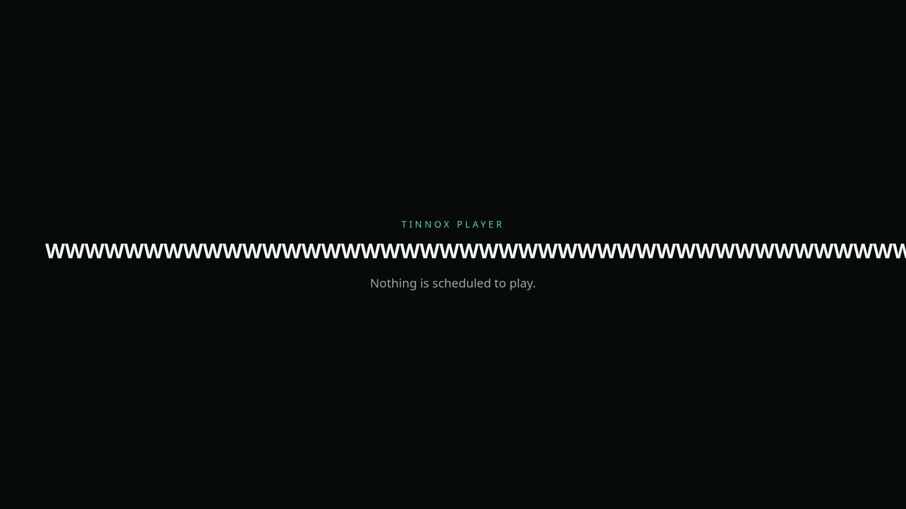
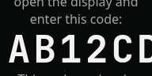
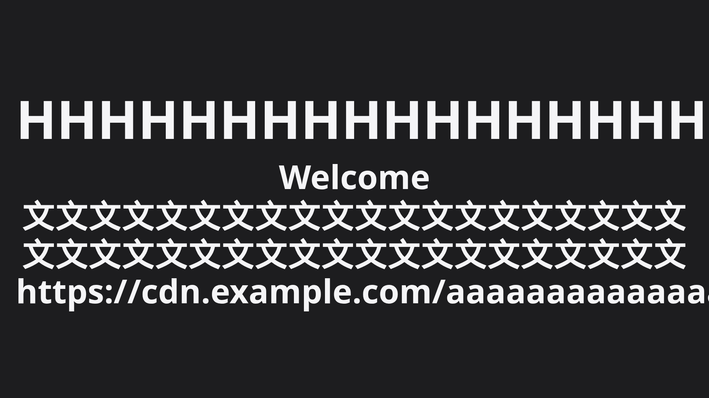
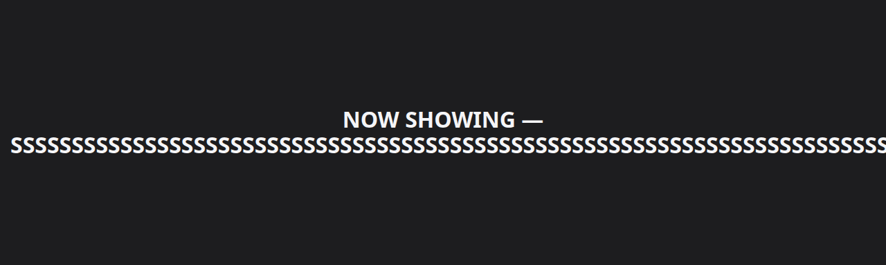
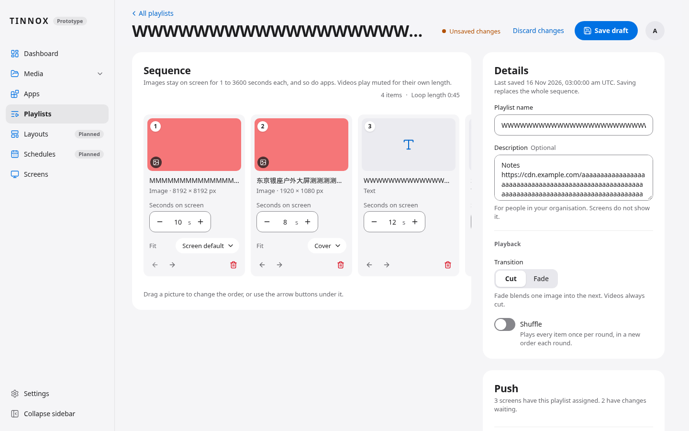
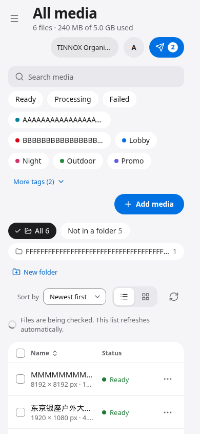

# Cursor report — areas 3 to 5

Date: 17 November 2026, Australia/Melbourne (UTC+11).

| Item | Value |
|---|---|
| Reviewer | Cursor cloud agent, model Grok 4.7, reasoning effort xhigh, 500k context window |
| Agent | [bc-a55803b3-afd4-5ae7-aec9-a599cba7bd27](https://cursor.com/agents/bc-a55803b3-afd4-5ae7-aec9-a599cba7bd27) |
| Baseline | `6d88bafcc6cc848f8a026de227ca452592a76597` (`main`) |
| Date of report | 17 November 2026, 01:11 (Australia/Melbourne) |
| Method | Runtime review of areas 3, 4 and 5. Playwright drove the Vite portal and player against schema-validated mocked API fixtures, because Docker was not available. Unit tests and production builds ran. End-to-end specs `04`, `06`, `07` and `08` did not run. No branch, commit, push, or pull request. |
| Path edits | Image and evidence paths of the form `/opt/cursor/artifacts/<filename>.png` have been rewritten as `screenshots/<filename>.png`. Finding anchors (`fcu-01` and so on) were added for navigation. The report text is otherwise unchanged. |
| Disposable VM paths | References to `/tmp/review/*` are left as written. Those files were on the reviewer’s disposable VM and are not in this folder. |
| This file | The report text below is from the reviewer’s final message, including its runtime-evidence appendix. |
| Consolidated summary | [README.md](README.md) |

---

# Frontend review, areas 3–5 (TINNOX CMS)

## 1. Baseline, scope, environment, methods

| Item | Value |
|---|---|
| Repository | `tinnox-au/tinnox-cms` |
| SHA | `6d88bafcc6cc848f8a026de227ca452592a76597` (`git rev-parse HEAD`) |
| Branch label | `main` (this SHA only; detached `HEAD`) |
| Tree at start | `git status --porcelain` empty |
| Tree at end | `git status --porcelain` empty. No branch, commit, push, or pull request. |
| Host | Ubuntu 24.04.5, Linux 6.12.113+, Node v22.23.4, npm 10.9.9, Google Chrome |
| What ran | `npm test` (unit), production builds of `@tinnox/portal` and `@tinnox/player-web`, then the real portal and player Vite apps driven by Playwright |
| What did not run | Docker is not installed on this machine, so PostgreSQL, Keycloak, the media worker, and `tests/e2e/{04,06,07,08}` did not run |

Areas 1 and 2 (portal architecture and player long-running behaviour) were left to the other reviewer. This report is layout, accessibility, and what the player and `packages/app-render` actually draw.

The portal was the development build at `http://127.0.0.1:5173`, including `/styleguide`. `GET /api/*` was fulfilled in the browser with fixtures checked against the Zod response schemas (`SessionResponseSchema`, `MediaListResponseSchema`, `DisplayListResponseSchema`, `PlaylistDtoSchema`, `AppDtoSchema`, `PushPlanResponseSchema`, and the rest). The hostile strings are inside the published limits: media names of 255 characters (`ABSOLUTE.maxOriginalNameLength`), display and playlist names of 120 (`maxNameLength`), tag names of 40, a folder name of 80, a text heading of 60, a message of 280 containing a long URL, a ticker of 300, a QR payload of 300, CJK, Arabic, and emoji. Player information screens used the player’s own `styles.css` and the DOM shape from `screens.ts`. Apps were drawn by the real `renderApp`. That is runtime evidence of CSS and rendering. It is not the Playwright end-to-end suite, and nothing was uploaded, paired, or pushed through the API.

## 2. Assessment of areas 3–5

The portal shell holds together. At 1440, 1280, 1024, 768, and 390, and with CSS zoom 200% on a 1440×900 window, `documentElement.scrollWidth - clientWidth` stayed at −15, which is the stable scrollbar gutter, not a sideways page. List pages drop columns, ellipsize the name, and keep the Add button on screen. Editor pages put the same long name in a field, so the truncated header is not the only copy. Dialogs are native `<dialog>` elements. At 1280×600 the Add-media dialog and the Push dialog still showed their footers. axe-core on the style guide reported no violations. On the signed-in pages the only violation was the wordmark sitting outside a landmark.

Two places lose content that an operator or a viewer has to read. Player information screens (`#screen`) hide overflow and do not break a long unbroken string, so a 120-character display name on a 1920×1080 window is a band of letters with both ends cut off, and a pairing code at 192×96 is cut off. Built-in Text, a QR caption, and a ticker under reduced motion clip a long token on every canvas that was tried, from 192×96 through 3840×2160, because the font will not go below one twelfth of the short side and a URL or a run of letters does not break. The portal does show the overflow warning on the app editor.

## 3. Prioritized findings

### FCU-01 — Player information screens clip an unbroken name, and a 192×96 window clips the pairing code

- **Severity:** High. **Classification:** New finding.
- **Trigger:** A display name of 120 `W` characters (the create limit in `NameSchema` / `ABSOLUTE.maxNameLength`) on the slate and on the unregistered screen, at a 1920×1080 window. The same window at 1280×384 and 192×96. A pairing code at a 192×96 window.
- **Consequence:** The slate is the public “nothing is playing” screen. The name is the only identification, and both ends are off the glass. The unregistered screen’s sentence runs off both edges, so the operator cannot read which screen was revoked; the Reset button stays visible. At 192×96 the pairing heading is above the window (`top: -64`) and the code’s scroll width is 261 px inside a 173 px box, so the code cannot be copied in full. Pairing at 1920×1080, 1080×1920, 3840×2160, 1280×384, and 390×844 kept the code inside the window.
- **Mechanism:** `#screen` is `position: fixed; inset: 0`, and `html, body` set `overflow: hidden` (`apps/player-web/src/styles.css:19-26`, `:117-127`). The slate title is an `h1` with `clamp(1.4rem, 4vmin, 3.2rem)` and no `overflow-wrap` (`styles.css:138-142`, `apps/player-web/src/ui/screens.ts:71-76`). On 1080p, 4 vmin is about 43 px; the measured box was 1728 px wide and the text’s scroll width was 5012 px. The revoked sentence interpolates the name into a `
` with the same gap (`screens.ts:86-93`, `styles.css:144-148`). The pairing code is `white-space: nowrap` with `font-size: clamp(3rem, 15vmin, 14rem)` (`styles.css:157-166`, `screens.ts:55`). The 3 rem floor is wider than a 192 px window. These screens are not letterboxed into the content canvas; they fill the window. A 192×96 canvas shown inside a large window would not hit the pairing clip. A browser opened at 192×96 would.
- **Evidence:** `screenshots/player-slate-1920x1080.png`, `screenshots/player-revoked-1920.png`, `screenshots/player-pairing-192x96.png`, `screenshots/player-pairing-1920x1080.png`. Geometry recorded in `/tmp/review/report.json`.
- **Confidence:** High.
- **Required property:** An unbroken name up to 120 characters, and the 8-character pairing code, stay fully readable on the windows the player is opened in, including 1920×1080 and 192×96. The page can wrap, shrink, or scroll. It cannot rely on `overflow: hidden` to discard the ends.

### FCU-02 — Text, a QR caption, and a reduced-motion ticker clip a long token on every canvas that was tried

- **Severity:** High. **Classification:** New finding. The font floor itself is a documented shortcut (section 5); the failure is that a token with no spaces never wraps, so the floor is reached immediately and the line is cut.
- **Trigger:** A Text app at the field limits: a 60-character heading of `H` and a message whose last line is `https://cdn.example.com/` plus a run of `a`. A QR caption of 80 `C`s. A ticker of `NOW SHOWING —` plus a run of `S`, drawn with `reducedMotion: true`. Canvases 192×96, 1280×384, 1920×1080, 1080×1920, and 3840×2160. `renderApp` reported `onOverflow(true)` for every Text and QR case, including 3840×2160.
- **Consequence:** On a 1920×1080 canvas the heading is cut at both edges and the URL is cut at the right edge. The same URL is cut on a 192×96 canvas. Under reduced motion the ticker, which scrolls when motion is allowed, becomes one static line with both ends off the strip. A viewer who needs reduced motion does not get the message. The app editor does show the warning banner (“Not all the text fits this screen shape”) and still offers Save (`screenshots/app-editor-1440.png`).
- **Mechanism:** `fitLines` tries `white-space: nowrap`, then `normal` (`packages/app-render/src/render.ts:96-101`). `normal` wraps at spaces. It does not break a URL. The body is `white-space: pre-line` (`render.ts:172`). The search will not go below `short / 12` (`render.ts:363-365`). On a 1080 px short side that floor is 90 px, which is already wider than a 200-character token, so the fitter stops and `overflow: hidden` on the root clips the line (`render.ts:311-314`). Reduced motion replaces the ticker with that same block (`render.ts:186-187`). The moving ticker on 1280×384 stays one large scrolling line and does not clip (`screenshots/app-ticker-1280x384.png`).
- **Evidence:** `screenshots/app-text-1920x1080.png`, `screenshots/app-text-192x96.png`, `screenshots/app-qr-192x96.png`, `screenshots/app-ticker-reduced-1280x384.png`, `screenshots/app-editor-1440.png`. A short CJK sentence did fit inside 192×96 (`screenshots/app-cjk-date-like-text-192x96.png`). A clock at 1080×1920 in `Australia/Melbourne` drew `2:00:00 pm` for `2026-11-16T03:00:00Z` (`screenshots/app-clock-1080x1920.png`).
- **Confidence:** High.
- **Required property:** A string the schema allows (a 300-character ticker, a URL inside a 280-character message, an 80-character caption) remains readable on a 1920×1080 canvas and on a 1280×384 strip, including when `prefers-reduced-motion: reduce` is set. The overflow flag can stay. It cannot be the only thing that makes the text readable.

### FCU-03 — Several portal surfaces ellipsize a long name and give the pointer no full value

- **Severity:** Medium. **Classification:** New finding.
- **Trigger:** A 255-character media name, a 120-character screen or playlist name, a 40-character tag, an 80-character folder name, and a 500-character screen description, at 1440 and at 390.
- **Consequence:** In the playlist strip each tile stays 212 px wide and the name ends in an ellipsis, so two files that share a long prefix cannot be told apart without leaving the editor. Dashboard rows do the same for the screen that needs attention and for the playlist caption under “Changes waiting”. Tag chips and the folder chip show about fifteen characters of a maximum-length name. The screen list’s second line is the description and is cut with no `title`. The page `h1` on an editor is also cut (media detail: 820 px visible, 7985 px of text). There the same string is in the name field on that page, so the header is a weaker instance of the same pattern.
- **Mechanism:** `NameCell` puts `title={name}` on the link (`apps/portal/src/ui/DataTable.tsx:412-416`). The organisation capsule puts `title` on the outer element (`apps/portal/src/shell/PageHeader.tsx:72-76`). These do not:

  - the page `h1` (`PageHeader.tsx:64`, ellipsis in `apps/portal/src/styles/shell.css:505-509`)
  - dashboard links (`apps/portal/src/features/dashboard/ScreensCard.tsx:200-204`, `PushCard.tsx:98-107`)
  - playlist tiles (`apps/portal/src/features/playlists/editor/SequenceTile.tsx:118-123`; tiles are `inline-size: 212px` in `playlistEditor.css:214-218`)
  - chip labels (`apps/portal/src/styles/chips.css:40-46`, `TagChips.tsx:66-70`, folder `ChipLabel` in `FolderChips.tsx:166-174`)
  - the screen row’s description, passed as `meta` (`ScreensList.tsx:445-451`); only the name receives `title`

  The accessible name is still the full string, because CSS ellipsis does not remove it from the accessibility tree. A pointer user hovering the chip or the tile does not get it. The `+N` tag tooltip did open and was 260×48 px for the short hidden names; the two long tags are the ones on display, and they are the ones without a tooltip.
- **Evidence:** `screenshots/playlist-editor-1440.png`, `screenshots/media-390.png`, `screenshots/account-menu-1440.png` (dashboard rows behind the menu), `screenshots/screen-detail-390.png`. Measured scroll widths are in `/tmp/review/report.json` (`playlist-editor-1440` tiles all 212 px; `tx-truncate` 188/3220; chip labels 158/358).
- **Confidence:** High.
- **Required property:** Where an ellipsis is the only visual copy of a name, the pointer can read the whole value the same way `NameCell` and the organisation capsule already allow. A field on the same page satisfies that for the object being edited.

### FCU-04 — Screen settings tabs at 390 px scroll with the scrollbar hidden

- **Severity:** Low. **Classification:** New finding.
- **Trigger:** Screen detail at 390×844. The tab list’s scroll width was 731 px and its client width was 343 px.
- **Consequence:** Overview, Canvas, Pairing, Tags, Working hours, Alerts, and Advanced do not fit. The scrollbar is suppressed, so there is no painted hint that Working hours is further along. Arrow keys still move the tabs (`apps/portal/src/ui/Tabs.tsx:54-66`), and a trackpad can drag the row.
- **Mechanism:** `.tx-tabs` is `overflow-x: auto; scrollbar-width: none`, and the WebKit scrollbar is `display: none` (`apps/portal/src/styles/controls.css:491-503`).
- **Evidence:** Probe `screen-detail-390` and `screen-hours-390` in `/tmp/review/report.json`. The first viewport of `screenshots/screen-detail-390.png` is the preview above the tabs.
- **Confidence:** High on the measurement. The hours form itself was below that screenshot and was not separately framed.
- **Required property:** At 390 px every screen-settings tab is reachable without a hidden gesture: a visible scroll affordance, wrapping, or a menu.

### FCU-05 — The wordmark is outside a landmark

- **Severity:** Low. **Classification:** New finding.
- **Trigger:** axe-core on Dashboard, Media, Playlists, Screens, Settings, Audit, and the app editor at 1440, light theme.
- **Consequence:** A landmark jump skips the brand and the visually hidden “Prototype” text. The navigation links themselves sit in the nav. The style guide, which does not use this shell, had no violations.
- **Mechanism:** axe rule `region` (moderate, two nodes) on `.tx-wordmark__name` and `.tx-wordmark__tag > .tx-visually-hidden`. The wordmark is the sidebar head (`apps/portal/src/styles/shell.css:169-178`), and the nav list is a sibling below it.
- **Evidence:** axe summary in `/tmp/review/report.json`. No other rule fired. Colour contrast did not fail on those pages.
- **Confidence:** High for the axe result.
- **Required property:** The brand is inside a landmark, or it is hidden from the accessibility tree when the nav already names the product.

### FCU-06 — One tab stop leaves an open dialog for the noscript fallback

- **Severity:** Low. **Classification:** New finding.
- **Trigger:** Keyboard only. On Media, activate Add media, then press Tab twelve times, then Escape. Viewport 1280×600 for the open dialog, then back to 1440.
- **Consequence:** The cycle is the dialog controls, then one stop whose text is “TINNOX CMS needs JavaScript to run.”, then the dialog controls again. Sidebar links were not in the cycle. Escape returned focus to `[data-testid=media-library-add]`.
- **Mechanism:** `index.html:22` is `<noscript>TINNOX CMS needs JavaScript to run.</noscript>`, a sibling of `#root`. The dialog is opened with `showModal()` (`apps/portal/src/ui/Dialog.tsx:81-83`), which inerts the rest of the page. This stop still took focus.
- **Evidence:** The twelve-step trace in the Playwright log (`dialog trap` in `/tmp/review/review.log`). `screenshots/add-media-dialog-1280x600.png`.
- **Confidence:** Medium. The focused text matches the noscript node. The element reference was not re-checked after the run.
- **Required property:** While a dialog is open, Tab stays on controls inside it.

## 4. Things done well

The page does not grow a horizontal scrollbar under the widths and the 200% zoom that were measured. At 390 the media library becomes a drawer, wraps the filters, keeps Add media on screen, folds extra tags into “More tags (2)”, and ellipsizes the file name (`screenshots/media-390.png`). `NameCell` and the organisation capsule already expose the full string to a pointer. Playlist tiles stay 212 px instead of growing to the 255-character name. The account menu wraps a 144-character display name inside the menu card (`screenshots/account-menu-1440.png`).

Dialogs use the native modal, and focus came back to the opener. The selection bar at 640 px held Move, Tags, and Delete without scrolling (`media-selection-640`: client width equalled scroll width). Player colours on `#060a09` measure well above 4.5:1: `#9aa5a1` 7.84, `#f2f4f3` 18.02, `#5fd0b3` 10.58, `#f0b860` 11.12 (`apps/portal/src/lib/contrast.ts`). `tokens.test.ts` is part of the unit run that passed. The moving ticker on a 1280×384 strip is a single large line. CJK in a short Text app fitted at 192×96 on this machine’s fonts. Diagnostics at 390 px wraps a 120-character value and a 64-character hex string (`screenshots/player-diagnostics-390.png`).

## 5. Documented residuals

These are still what the code says they are. They showed up in the rendering run.

**QR modules under 2 CSS pixels** (`packages/app-render/src/render.ts:246`). A 300-character payload encodes as a 69-module code. In a 192×96 box the SVG was 79 px, about 1.14 px per module, which will not scan. In a 1920×1080 box it was 895 px, about 13 px per module. The caption still overflowed in both.

**Readability floor of one twelfth of the short side** (`render.ts:363-365`, and the stage B note that text wraps only after that floor). The floor is why FCU-02 clips instead of shrinking further. The portal banner for that flag is implemented and was visible.

**Pairing and slate screens are not rotated** (`apps/player-web/src/ui/screens.ts:10`). They are full-window overlays. A 90° publication does not turn them. That is why FCU-01 is a window-size problem, not a canvas-size problem.

**Apps have no grid, bulk selection, or pagination** (`apps/portal/src/features/apps/AppsPage.tsx:46`). Not exercised past a handful of rows.

## 6. Runtime evidence

| Command | Outcome |
|---|---|
| `git rev-parse HEAD` | `6d88bafcc6cc848f8a026de227ca452592a76597` |
| `git status --porcelain` | empty at start and at end |
| `npm test` (`vitest run --project unit`, vitest 5.1.0) | 69 files, 1469 tests, 0 failed, 4.77 s. Log: `/tmp/review/npm-test.log` |
| `npm run build -w @tinnox/portal` | exit 0, built in 777 ms. One chunk is over 500 kB (`index` 548 kB). Log: `/tmp/review/build-portal.log` |
| `npm run build -w @tinnox/player-web` | exit 0, built in 98 ms, including `dist/sw.js`. Log: `/tmp/review/build-player.log` |
| `tests/e2e/04-portal-details.spec.ts`, `06-stage-b`, `07-apps-player`, `08-apps-portal` | Not run. Docker is absent, so `npm run infra:up` cannot start PostgreSQL, Keycloak, or the media worker. |

Playwright used the installed Google Chrome (`channel: 'chrome'`), portal `http://127.0.0.1:5173`, player `http://127.0.0.1:5174`. The portal’s `/api` responses were the schema-checked fixtures in `/tmp/review/fixtures.json`. No browser console errors were recorded. axe-core (`@axe-core/playwright` 4.11.0) ran on the style guide and on seven signed-in pages at 1440, light theme. Dark theme and `page.emulateMedia({ reducedMotion })` were not applied to the portal: the script called `context.emulateMedia`, which this Playwright build does not provide, and that call stopped the portal half of the run after the screenshots above. Reduced motion was passed straight into `renderApp` for the ticker.

### Screenshot index

| Path | What it shows |
|---|---|
| `screenshots/player-slate-1920x1080.png` | FCU-01, 120-character name cut on both sides |
| `screenshots/player-revoked-1920.png` | FCU-01, revoked sentence cut; Reset still visible |
| `screenshots/player-pairing-192x96.png` | FCU-01, pairing code cut |
| `screenshots/player-pairing-1920x1080.png` | Pairing code fits at 1080p |
| `screenshots/player-pairing-1080x1920.png` | Pairing code fits in portrait |
| `screenshots/player-pairing-1280x384.png` | Pairing code fits on a strip |
| `screenshots/player-live-unpaired-1280.png` | Live player, API down, error line readable |
| `screenshots/player-diagnostics-390.png` | Long values wrap |
| `screenshots/player-diagnostics-192x96.png` | Diagnostics panel at 192×96, value below the first screen |
| `screenshots/app-text-1920x1080.png` | FCU-02 |
| `screenshots/app-text-192x96.png` | FCU-02 at the small window |
| `screenshots/app-ticker-1280x384.png` | Moving ticker, large and scrolling |
| `screenshots/app-ticker-reduced-1280x384.png` | FCU-02, still ticker clipped |
| `screenshots/app-qr-192x96.png` | QR about 1 px per module, caption clipped |
| `screenshots/app-clock-1080x1920.png` | Clock in Australia/Melbourne |
| `screenshots/app-cjk-date-like-text-192x96.png` | Short CJK sentence fits |
| `screenshots/app-editor-1440.png` | Overflow banner, name field holds the full title |
| `screenshots/playlist-editor-1440.png` | FCU-03 tiles |
| `screenshots/media-390.png` | FCU-03 chips and a layout that holds |
| `screenshots/media-zoom-200.png` | 200% zoom reflow, no sideways page |
| `screenshots/account-menu-1440.png` | Long display name wraps in the menu |
| `screenshots/screen-detail-390.png` | Header ellipsis; preview caption wraps the file name |
| `screenshots/push-dialog-1280x600.png` | Push dialog at a short height |
| `screenshots/add-media-dialog-1280x600.png` | Add-media dialog at 1280×600 |
| `screenshots/styleguide-1440.png` | Style guide, axe-clean |

Other frames from the same run (768, 1024, portrait pairing, 4K pairing, dark-theme attempt that did not complete) are in `screenshots/` under the same naming. Geometry and axe JSON: `/tmp/review/report.json`.

## 7. Open questions

1. Is 192×96 a player window, or only a content canvas that the player letterboxes inside a larger window? Pairing and the slate fill the window, so the answer changes whether FCU-01’s small-window case is a device the product will open.
2. Should Save on an app stay available after the preview has reported overflow? The banner is there. The player will clip whatever is saved.
3. The CJK sample rendered on this Ubuntu image through the system fallback. The portal ships Inter for Latin only (`apps/portal/src/styles/fonts.css`). A signage image with no CJK face will show missing glyphs. Is a CJK face part of the player image?
